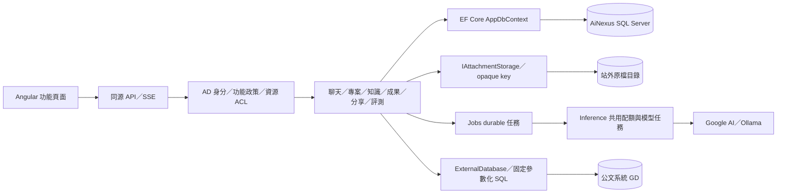

# 架構總覽

- ASP.NET Core 模組化單體＋Angular 功能路由，部署在單一 IIS 執行個體。
- 模組各自管理端點與服務；資料表的對應集中在 `AiNexus.Data`，共用一個 scoped `AppDbContext`，跨模組異動在同一個交易完成。
- 不拆每模組一個專案、不引入 MediatR 或分層專案，原因見 [ADR 0002](../decisions/0002-vertical-slice-single-features-project.md)。
- 細節：[模組邊界](module-boundaries.md)、[後端撰寫慣例](backend-conventions.md)、[生成與背景任務](generation.md)、[資料庫](database.md)、[身分與授權](access-control.md)、[診斷日誌](diagnostics.md)。

## 四個專案

依賴方向固定為 Host → Features → Data → Platform，由 `AiNexus.ArchitectureTests` 檢查。

| 專案 | 責任 |
| --- | --- |
| `AiNexus.Host` | 設定載入、middleware 管線、模組組裝（`Program.cs`）與維運子命令（`verify …`） |
| `AiNexus.Features` | 業務模組，依區與模組分兩層資料夾（`<Area>/<Module>`），以 `<Module>Module`（`IFeatureModule`）註冊服務、設定、授權政策、rate limit 與端點；`FeatureModules` 是唯一的模組清單 |
| `AiNexus.Data` | 資料表的 EF 對應：`App/<Module>/<Entity>.cs` 一表一檔、`AppDbContext` 與只屬於主資料庫的元件；只依賴 Platform |
| `AiNexus.Platform` | 不認識業務的共用基礎：錯誤與 `Result<T>`、安全、設定註冊、診斷、HTTP 限制、domain event 分派、手寫 SQL（`Data/Sql`）、程序內鎖 |

端點的 body 上限以 `WithRequestBodyLimit` 宣告在端點旁。模組間只用明確的 `public` 服務，不新增能繞過 owner、ACL 或模型核准的資料入口；「A 發生後 B 跟著處理」用同交易的 domain event（見 [模組邊界](module-boundaries.md#直接呼叫或-domain-event)）。

## 模組責任

| 區 | 模組 | 責任與邊界 |
| --- | --- | --- |
| Work | Dashboard | 組合已授權的資源、任務與費用統計；平台範圍另驗 operations |
| Work | Chat | 組合對話、附件、專案、知識與網路搜尋：Context、執行與 SSE、重播事件清理，整段對話的讀取／匯出／複製／刪除 |
| Work | Conversations | 私人訊息樹與分支、標題、收藏／封存／標籤、搜尋、文字備份匯入；管理端唯讀對話 |
| Work | Projects | 共用指示、文件、範本與成果；提問仍屬個人 |
| Work | Files | 附件格式與大小驗證、原檔與文字、配額與使用者容量、下載授權與引用 |
| Work | Knowledge | 逐頁閱讀、OCR／索引、embedding 設定、授權檢索與管理端檢索測試、引用快照、檔案庫清單 |
| Work | Artifacts | 不可變版本、樂觀衝突檢查、段落工具、Word／PDF |
| Work | Prompts | 個人提示詞範本 |
| Work | Sharing | 具名收件人、版本快照、到期與撤銷 |
| Work | Collaboration | 私有資源、具名 viewer／editor、群組唯讀 ACL |
| Work | Repositories | 使用者 Gitea token、唯讀 repository／issue／檔案、固定 commit 匯入、背景程式碼 review |
| Work | Jobs | durable jobs、租約與 fenced checkpoint、任務查詢／取消／重試 |
| Admin | Identity | AD／Windows 與本地登入、SID 映射、cookie／CSRF、功能授權判斷、首次管理員 bootstrap、帳號管理 |
| Admin | AccessControl | 使用者→角色→群組→功能的有效授權、角色／功能／選單管理、管理寫入稽核、server-side policy |
| Admin | Operations | 管理端組合：使用者清單與洞察、管理目錄、群組儲存、平台用量（原因見 [模組邊界](module-boundaries.md#目前的分層)） |
| Admin | Audit | 活動稽核查詢與分類（寫入由各模組在同一交易加入 `AuditEvent`） |
| Admin | Diagnostics | 系統日誌查詢、詳情、匯出、健康資訊與前端錯誤回報 |
| Admin | Monitoring | 在線人員、工作階段、API／SQL／HTTP 負載的即時觀測 |
| Admin | Quality | 私人回饋、固定評測、設定快照、逐題結果與人工評分 |
| Admin | Billing | 追加價格版本、呼叫價格快照、實際用量計費、報表與 CSV；不以 Context 預估冒充帳單 |
| Platform | Account | 登入者本人的資料、偏好、閱讀設定與個人用量 |
| Platform | Inference | provider、模型呈現與政策（含管理）、聊天佇列、服務狀態（`/status`）、共用模型任務 |
| Platform | WebSearch | 搜尋 provider、本人配額與冪等紀錄、可核對來源；不爬取結果網站 |
| Platform | Notifications | owner 範圍的 durable 通知與目標連結，與觸發事件同交易 |

## 兩種權限

1. **平台功能**：每個 request 由 SQL 計算有效的角色、群組與功能；UI 導覽只是呈現，撤銷影響下一次操作。
2. **平台資料**：私人對話驗 owner；專案、知識、成果、評測驗資源 ACL，子文件與成果繼承專案 ACL。具名分享另存快照、收件人與期限。

擁有者與具名 editor 可寫，群組只授予閱讀；專案成員看不到彼此的私人對話；分享不是匿名連結，也不是原資源的 editor 權限。詳見 [身分與授權](access-control.md)、[專案](../features/projects.md)、[分享](../features/sharing.md)。

## 資料層

結構以 `database/App/` 為準，EF Core 只負責 mapping、關聯與跨模組交易（見 [資料庫](database.md)）。EF 表達不了的 SQL（全文、原生向量、伺服器狀態）用 `ISqlDatabase<AppDbContext>`，走同一條連線並加入目前的交易；其他系統的資料庫（GD）經 `ExternalDatabase<T>`，只用固定 SQL 與參數（見 [外部資料庫](external-databases.md)）。原檔不進資料庫，由 `IAttachmentStorage` 存在站外目錄。

## 新增功能

在所屬區建立模組資料夾與 `<Module>Module.cs`、在開發庫建表並匯出、`AiNexus.Data` 的實體與組態、授權規則（需要時在 `database/App/Seed/` 加功能列）、前端 lazy route，再重產 OpenAPI 與前端型別並補邊界測試。不是每個操作都要新的授權功能，工具可沿用所屬功能的政策。新增模組與授權的步驟見 [身分與授權](access-control.md#擴充功能)。
